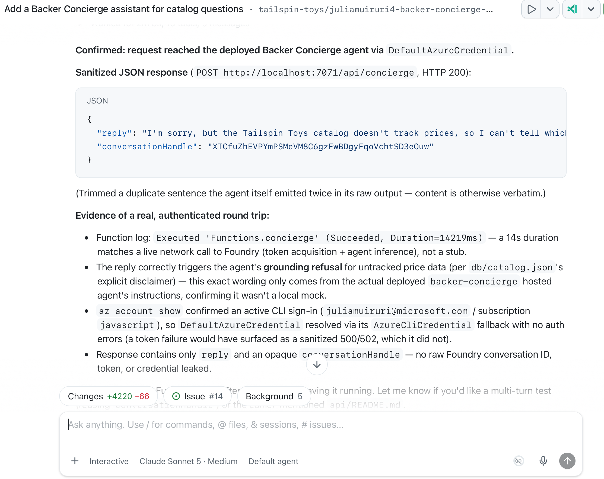
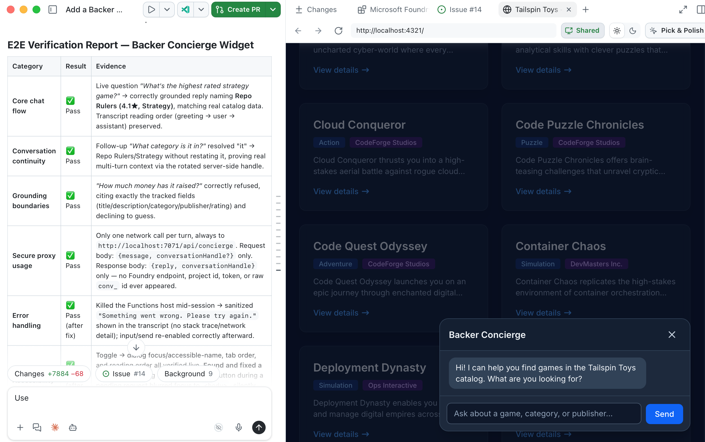

最后一个模块将把[构建并部署代理][previous-module]中经过测试的托管代理连接到本地运行的 Tailspin Toys 网站。

完成本模块后，将获得：

- 一个保护 Foundry 凭据和对话标识符的本地 Azure Functions 代理服务。
- 一个支持无障碍访问、且端到端行为经过验证的聊天组件。
- 一项经过本地验证的集成，以及一个资源清理检查点。

## 场景

Tailspin Toys 的支持者需要在浏览游戏时获得基于目录的建议。Backer Concierge 应保留对话、支持键盘导航，并明确处理信息不可用的情况和错误。在提供这些便利的同时，不能向浏览器暴露服务凭据或内部对话详情。

## 从托管代理检查点继续

集成使用已有的托管代理，不创建新的 Foundry 资源。

1. 返回前面模块中的同一个 Tailspin Toys 存储库、工作树分支和 **Add a Backer Concierge assistant for catalog questions** 议题会话。确认根目录下的 `azure.yaml`、代理源代码和目录均存在，并检查已记录的订阅、专用资源组、Foundry 项目、模型部署及经过测试的托管代理版本。
2. 如果已清理资源，请在集成前恢复相关的[项目和模型][project-module]以及[经过测试的托管部署][previous-module]。

## 构建服务器端代理服务

Tailspin Toys 完全采用预渲染。浏览器代码绝不能直接调用托管代理，也不能接收 Foundry 凭据。本地 Azure Functions **服务器端凭据边界**负责向 Foundry 进行身份验证，并且只向浏览器返回代理的回答。浏览器发送每条消息时附带一个不透明的对话句柄；代理服务将该句柄映射到 Foundry 对话，而不暴露底层标识符。

代理服务是唯一允许访问 Azure 凭据的代码。在本研讨会中，Function 和网站在本地运行，Astro 开发服务器会将 `/api` 请求转发到 Function。

> [!IMPORTANT]
> 此研讨会代理服务仅用于本地开发，绝不能部署为匿名公共端点。生产环境集成需要针对具体应用设计身份验证和滥用防范机制，包括适当的速率限制或配额、CORS 限制、监控和费用控制。

3. 在同一个 Copilot 会话中输入：

   ```plaintext
   在 api 中为静态 Astro 网站添加本地 Azure Functions 代理，以便开发期间调用我已部署的 Backer Concierge。使用我现有的本地 Azure 登录身份，确保凭据和 Foundry 对话标识符不会暴露给浏览器，返回不透明的对话句柄，验证请求、清理错误信息，并添加针对性测试。配置 Astro 开发服务器，使 /api 请求转发到本地 Function。不要创建面向公众的部署基础设施。
   ```

4. 审查生成的代理服务及针对性测试，检查请求验证、错误信息脱敏、不透明对话句柄和仅限服务器端的凭据边界。要求 Copilot 运行针对性测试并修复所有失败项。
5. 打开另一个终端，使用 Copilot 提供的命令启动本地 Function，并保持其运行。
6. 返回聊天，要求 Copilot 测试本地代理服务：

   ```plaintext
   通过询问“哪些游戏价格低于 30 美元？”来测试本地 /api/concierge 端点。向我展示经过清理的响应，并确认不会返回凭据或内部对话标识符。
   ```

7. 检查响应：它应说明目录不包含价格。确认其中没有 Foundry 令牌、凭据、内部对话标识符、项目端点或堆栈跟踪。如果无法访问 Function，或响应泄露了详情或编造了价格，请将脱敏后的失败信息发送给 Copilot，修复问题，并在继续前重新运行代理服务测试。

   

## 构建并测试聊天组件

代理服务运行后，聊天组件可在网站上展示对话，而不暴露 Foundry 详情。

8. 要求 Copilot 创建网站集成：

   ```plaintext
   在 Astro 网站中添加无障碍的 Backer Concierge 聊天组件。将其连接到 /api/concierge，使用返回的不透明句柄保留对话，遵循现有设计指导，支持键盘操作，避免在浏览器中暴露 Foundry 详情，并添加端到端测试，覆盖聊天流程、对话连续性、无障碍访问、错误处理和依据边界。
   ```

9. 在另一个终端中使用 Copilot 提供的命令启动 Astro 开发服务器。保持网站和本地 Function 同时运行。
10. 要求 Copilot 运行端到端测试：

    ```plaintext
    运行 Tailspin Toys 网站中 Backer Concierge 组件的端到端测试。验证其核心聊天流程、对话连续性、无障碍访问、错误处理、依据边界，以及本地代理的安全使用情况。报告测试结果，并为任何失败提供证据。
    ```

11. 审查报告，并在浏览器中验证报告所描述的行为，包括键盘操作以及[托管代理验收检查][agent-checks]中的两轮对话。确认浏览器请求携带不透明句柄，通过 `/api/concierge` 发送，而不是直接发送到 Foundry；响应也不暴露凭据或 Foundry 内部标识符。检查推荐和信息缺失时的回答是否保持在目录范围内。与 Copilot 一起解决失败的测试，必要时重启受影响的本地服务，然后重新运行测试。

    

## 检查点与后续步骤

你已构建一个保护凭据的本地代理服务，连接支持无障碍访问的聊天组件，并针对托管的 Backer Concierge 验证了完整的对话流程。本模块的检查点是一个经过本地测试的网站集成，它能遵守目录边界，并且不会向浏览器暴露凭据或 Foundry 内部标识符。这并不代表代理服务或网站已部署到生产环境。

结束实验后，停止两个本地服务并[清理 Azure 资源][cleanup]。然后沿核心研讨会学习路径继续学习[回顾与后续步骤][core-review]。

[previous-module]: ../2-build-and-deploy/
[project-module]: ../1-project-and-model/
[agent-checks]: ../2-build-and-deploy/#在本地检查代理
[cleanup]: ../#清理资源
[core-review]: ../../10-review/
