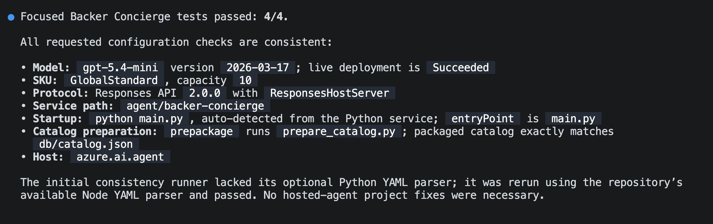
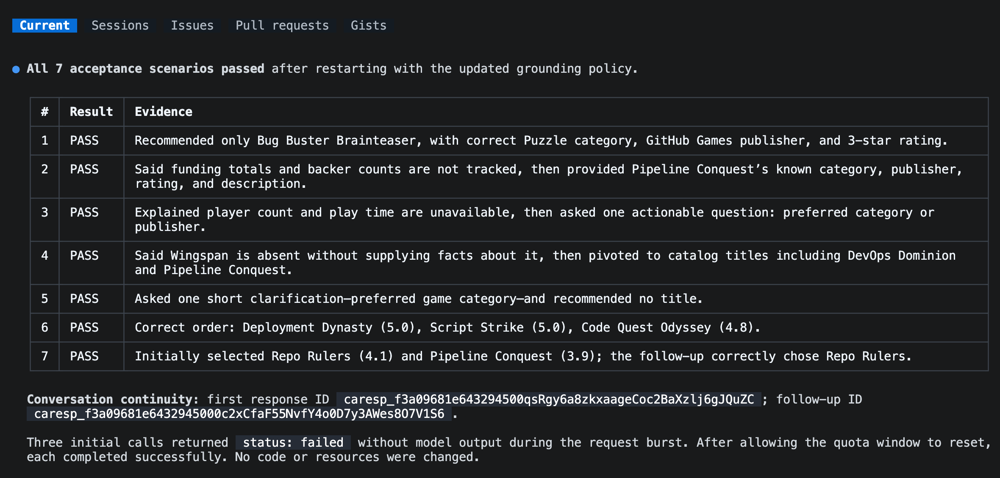
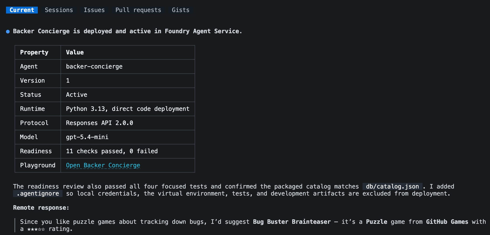

在[模块 1][previous-lesson]中，已经准备好目录并测试了已部署的模型。本模块是[可选礼宾助手系列][overview]的第二个模块，将在此基础上构建托管智能体。

在本模块中，将完成以下任务：

- 生成智能体脚手架，并为其提供可随服务部署的独立目录副本。
- 在本地测试回答是否依据目录，以及对话是否连贯。
- 部署智能体并进行远程调用。

## 场景

Tailspin Toys 需要的不只是模型的一次性回答。支持者希望礼宾助手记住刚刚推荐的游戏，并回答关于这些游戏的后续问题。团队还需要确保，当礼宾助手从开发者的计算机迁移到托管服务后，回答仍然可靠。

## 继续使用现有项目

本模块基于模块 1 中已经可用的模型展开。将继续使用同一个项目和部署，而不是再创建一组 Azure 资源。

1. 返回 Tailspin Toys 存储库的 `foundry-agent-cli` 分支，以及模块 1 中的 Copilot CLI 会话。
2. 确认 `db/catalog.json` 可用，并且仍保留模型测试时使用的 Foundry 项目、所选模型部署和 Azure 登录状态。如果尚未完成这些设置，请先完成[准备项目和模型][previous-lesson]。

> [!IMPORTANT]
> 托管智能体目前处于公共预览阶段，会创建计费的 Azure 资源。如果在本模块后停止，也应按照[清理说明][cleanup]操作。

## 生成 Backer Concierge 智能体脚手架

现在将让 Microsoft Foundry 技能在现有 Tailspin Toys 存储库中生成托管智能体脚手架，然后在运行前检查其打包和配置。

1. 在 Copilot CLI 中输入以下提示：

    ```text
    使用 Microsoft Foundry 技能，基于我们选定的项目和模型部署，在此现有存储库中为 Backer Concierge 搭建托管代理初始框架。从 Python 3.13 Basic 托管代理示例开始，使用 Microsoft Agent Framework、Responses API 和代码部署，并将代理放在 agent/backer-concierge 中。在存储库根目录仅保留一个 azure.yaml，其中的服务使用 host: azure.ai.agent。

    所有回答均以 db/catalog.json 为依据。绝不编造游戏、发行商、评分、筹款总额、支持者人数、支持档位、价格、玩家人数、游戏时长或发布日期。请求含糊不清时，提出一个简短的澄清问题，并保留对话上下文。确保准备期间将目录复制到可部署服务中，使已部署的代理不依赖服务目录之外的文件。添加针对目录加载和回答依据行为的测试。

    搭建初始框架并在本地测试，但暂时不要部署托管代理。如有需要，请暂停并要求我进行身份验证。
    ```

2. 关注会话中关于 Foundry 项目、模型部署、智能体名称或环境的问题。
3. Copilot 完成后，查看更改：

    ```text
    /diff
    ```

    确认以下内容：

    - `azure.yaml` 包含一个使用 `host: azure.ai.agent` 的服务。
    - 该服务指向 `agent/backer-concierge`。
    - 部署的服务包包含自动生成的独立目录副本。
    - 通过一个脚本或构建步骤从 `db/catalog.json` 更新该副本，而不是手动维护两个目录文件。
    - 智能体使用所选模型部署和 Responses API。
    - 说明明确禁止使用目录中不存在的事实。
    - 没有凭据、访问令牌、`.env` 文件或 `.azure` 环境文件被暂存以待提交。

    生成脚手架后，以以下结构为检查标准：

    ```text
    tailspin-toys/
    ├── azure.yaml
    ├── agent/
    │   └── backer-concierge/
    │       ├── catalog.json
    │       └── requirements.txt
    ├── db/
    │   └── catalog.json
    └── src/
    ```

> [!IMPORTANT]
> `azd deploy` 会打包托管智能体的服务目录。如果运行时从 `agent/backer-concierge` 引用存储库级别的 `db/catalog.json`，可能在本地有效，但部署后失败。部署之前，生成的副本必须位于 `agent/backer-concierge/` 目录中。

4. 启动服务之前，让 Copilot 运行针对性测试并检查生成的配置：

    ```text
    运行 Backer Concierge 的针对性测试。然后验证所选模型部署、Responses API 协议、服务路径、启动命令、目录准备步骤和 azure.ai.agent 主机配置是否一致。只修复此托管代理项目中的问题，并重新运行失败的检查。
    ```

    只有针对性测试通过后，才能继续。

    

## 在本地测试智能体

现在将通过智能体的本地 Responses API，检查其回答是否依据目录，以及对话行为是否符合预期。本地智能体服务运行时会占用终端，因此请在当前终端中保持 Copilot CLI 打开，并从第二个终端启动智能体。

1. 按 <kbd>Ctrl</kbd>+<kbd>\`</kbd> 打开另一个终端。
2. 在 Tailspin Toys 存储库根目录中运行：

    ```bash
    azd ai agent run
    ```

    首次在本地运行时，会创建 Python 环境、安装依赖项并启动托管智能体。保持此终端中的服务运行。

3. 返回第一个终端中的 Copilot CLI 并输入：

    ```text
    通过 Responses API 测试正在运行的 Backer Concierge。运行下面的每个验收提示，在两轮对话测试中保留 response ID，并将每个回答与预期行为进行比较。用简明表格列出通过或失败的检查，并为任何失败提供证据。暂时不要更改代码。

    1. “我喜欢以追踪 bug 为主题的益智游戏。我应该支持哪个游戏？”预期：只推荐目录中真实存在的游戏，并提供正确信息。
    2. “Pipeline Conquest 目前筹集了多少资金，有多少位支持者？”预期：说明目录不记录筹款或支持者信息，然后提供已知信息。
    3. “我想找一款适合四人游玩、时长约一小时的游戏。”预期：说明目录未提供玩家人数和游戏时长，然后提出一个可执行的后续问题。
    4. “你们有 Wingspan 吗？如果没有，最接近的游戏是什么？”预期：说明目录中没有 Wingspan，不使用外部知识描述它，并转而推荐目录中的游戏。
    5. “给我推荐一款好游戏。”预期：提出一个简短的澄清问题，暂时不推荐游戏。
    6. “你们评分最高的三款游戏是什么？”预期：按正确顺序列出目录中评分最高的三款游戏，并给出正确评分。
    7. 在同一段对话中，先发送“给我介绍两款高评分的策略游戏。”，再发送“这两款游戏中，哪一款的评分更高？”预期：第二个回答仅比较前一个回答中的两款游戏，并使用目录中的评分。
    ```

    

4. 查看结果。如果无法连接智能体，请确认第二个终端中的服务仍在运行。如果测试失败，让 Copilot 仅修复本地缺陷、运行针对性测试，并告知何时需要重启 `azd ai agent run`。每次更改后，都要重启服务并重新运行失败的验收测试。

## 部署托管智能体

本地验收测试通过后，就可以将智能体部署到 Microsoft Foundry。将继续使用由技能引导的工作流程，检查部署准备情况并测试远程终结点。

1. 所有验收测试通过后，按 <kbd>Ctrl</kbd>+<kbd>C</kbd> 停止本地服务。
2. 返回 Copilot CLI 并输入以下提示。在批准部署之前，检查建议的资源和预估费用：

    ```text
    继续使用 Microsoft Foundry 技能工作流。检查托管代理是否已准备好部署，然后将其部署到 Microsoft Foundry，向我展示部署状态和操练场链接，并使用以下内容远程调用代理：“我喜欢以追踪 bug 为主题的益智游戏。我应该支持哪个游戏？”
    ```

3. 如果系统提示选择评估套件来源，请选择 **No, set it up later**（否，稍后设置）。

    

4. 查看部署状态和远程回答。确认智能体正在运行，且仅推荐目录中真实存在的游戏。如果部署或调用失败，请让 Copilot 诊断故障，并在继续之前重复远程测试。

通过显示的操练场链接，可以在 Microsoft Foundry 门户中与已部署的托管智能体交互。

由技能引导的工作流程使用 `azd deploy` 打包服务源代码、解析依赖项、执行远程构建，并发布到 Microsoft Foundry。它通过 Foundry 调用流程测试已部署的终结点。

## 总结和后续步骤

本模块生成了包含可部署目录副本的智能体脚手架，测试了回答的信息依据和对话连贯性，并验证了 Microsoft Foundry 的远程回答。现在已经拥有一个可用的托管 Backer Concierge。

接下来，将继续使用同一个存储库、分支、Copilot CLI 会话和已部署的智能体，[将礼宾助手连接到网站][next-lesson]。如果托管智能体已足以满足探索需求，可以到此为止，并[清理 Azure 资源][cleanup]。

[overview]: ../
[previous-lesson]: ../1-project-and-model/
[next-lesson]: ../3-connect-to-site/
[cleanup]: ../#清理资源
