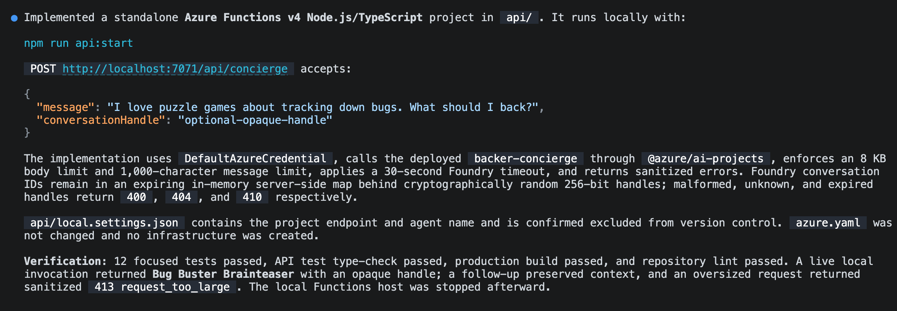
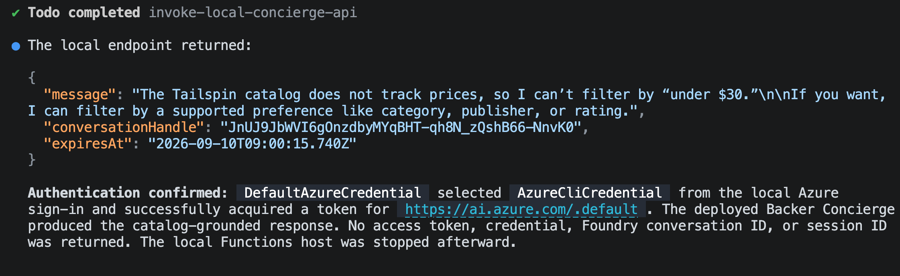
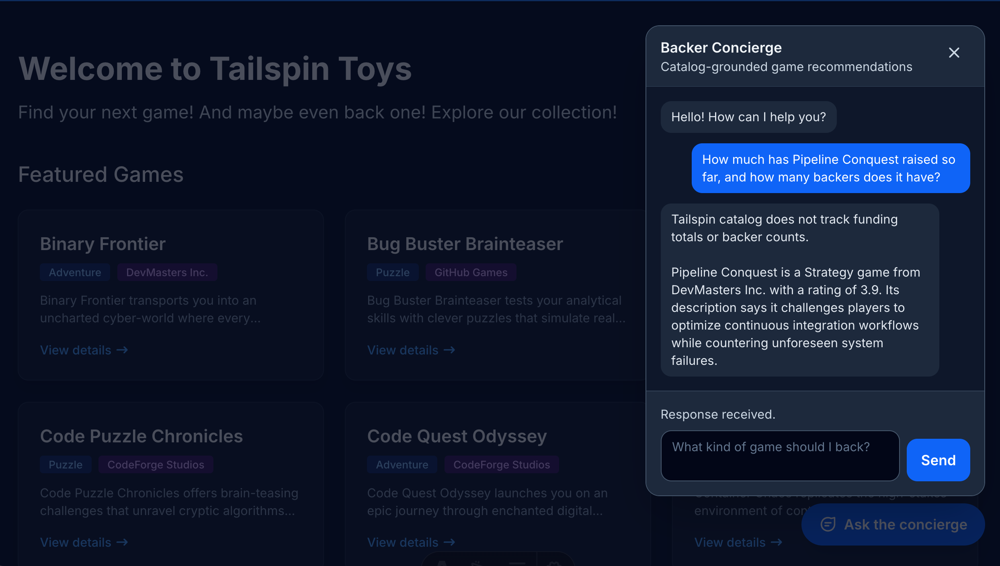

在[模块 2][previous-lesson]中，已经部署并测试了 Backer Concierge。本模块是[可选礼宾助手系列][overview]的最后一个模块，将让本地 Tailspin Toys 网站能够使用该智能体。

在本模块中，将完成以下任务：

- 构建本地 Azure Functions 代理，将 Foundry 凭据保留在服务端。
- 向网站添加无障碍聊天组件。
- 验证完整的对话流程并清理资源。

## 场景

支持者在 Tailspin Toys 网站上发现游戏，而不是在开发者的终端或 Azure 门户中。团队希望在目录旁提供礼宾助手，其聊天体验应支持追问，并保护服务凭据。

## 继续使用已托管的智能体

网站集成需要模块 2 中已部署的智能体。代理和网站在本地运行期间，智能体将继续在 Foundry 中运行。

1. 返回 Tailspin Toys 存储库的 `foundry-agent-cli` 分支，以及现有的 Copilot CLI 会话。
2. 确认 Backer Concierge 已部署，并且[构建并部署智能体][previous-lesson]中的远程调用已通过验证。如果已经移除了 Azure 资源，请先按照前面的模块重新创建，再继续。

> [!IMPORTANT]
> 本模块中的代理和网站在本地运行，并非生产网站部署。在完成[清理][cleanup]之前，模型和托管智能体仍是计费的 Azure 资源。

## 构建服务端代理

Tailspin Toys 采用完全预渲染方式。浏览器代码绝不能直接调用托管智能体或接收 Foundry 凭据。将添加一个本地 Azure Functions **服务端凭据边界**，由它向 Foundry 进行身份验证，并仅将智能体的回答返回给浏览器。

`microsoft-foundry` 技能负责托管智能体的工作流程，而同一插件中用途更广泛的 Azure 技能可用于准备本地 Function 项目。将使用这些技能构建代理，然后检查代理能否在不暴露凭据的情况下访问智能体。

1. 在 Copilot CLI 中输入：

    ```text
    使用 Azure 技能在 api 中添加 Azure Functions v4 Node.js 和 TypeScript 项目，并设置一个 POST /api/concierge 端点以调用我已部署的 Backer Concierge 托管代理。此 Function 仅在本地运行；不要将其加入 azure.yaml，也不要创建 Azure 部署基础设施。使用我通过本地 Azure 登录身份获取的 DefaultAzureCredential。保持 HTTP 触发器逻辑精简，将 Foundry 客户端隔离在可进行单元测试的模块中，验证并限制请求正文，设置明确的超时时间，并返回经过清理的错误。将 Foundry 项目端点和代理名称存储在不纳入版本控制的本地服务器端设置中。绝不要向浏览器返回凭据或访问令牌。Astro 网站的 `output: 'static'` 且没有开发代理，因此还要在 astro.config.mjs 中添加仅限本地的 Vite 开发服务器代理，将 /api 请求转发到 Function 的端口，使相对路径 /api/concierge 请求可在 `astro dev` 期间到达 Function。

    对于对话状态，在服务器上生成高熵句柄，在服务器端将其映射到 Foundry 对话并设置过期时间，绝不暴露原始 Foundry 对话或线程标识符。拒绝格式错误、已过期和未知的句柄。添加针对性单元测试。
    ```

    

2. 打开另一个终端，然后使用 Copilot 提供的命令启动本地 Function。保持 Function 运行。
3. 返回 Copilot CLI，让 Copilot 测试本地代理：

    ```text
    向本地 /api/concierge 端点发送请求，询问“哪些游戏价格低于 30 美元？”，并向我展示经过清理的 JSON 响应。确认请求通过 DefaultAzureCredential 到达已部署的 Backer Concierge。
    ```

4. 查看响应。它应说明目录不包含价格。响应中不得包含 Foundry 令牌、凭据、项目终结点、原始 Foundry 对话标识符或堆栈跟踪。

    

## 构建聊天组件

代理为浏览器提供了安全访问礼宾助手的方式。现在将向网站添加聊天组件，并使用 Playwright 检查完整的对话流程。

1. 让 Copilot 创建网站集成：

    ```text
    将无障碍的 Backer Concierge 聊天组件添加为 Astro 组件，并通过 Layout.astro 在整个网站中渲染。该组件应向 /api/concierge 发送 POST 请求，使用返回的不透明对话句柄维持对话，遵循 style.instructions.md 中的深色主题，支持按 Escape 关闭，并包含 data-testid 属性。
    ```

2. 保持本地 Function 运行，并在另一个终端中使用 Copilot 提供的命令启动 Astro 网站。
3. 返回 Copilot CLI。在[练习 4][playwright-lesson]中添加的 Playwright MCP 服务器已可用。让 Copilot 测试组件：

    ```text
    使用 Playwright MCP 服务器，在正在运行的 Tailspin Toys 网站中对 Backer Concierge 组件进行端到端测试。验证核心聊天流程、对话连续性、无障碍访问、错误处理、依据边界，以及本地代理的安全使用情况。报告结果，并为任何失败提供证据。
    ```

    

4. 根据报告中的证据检查结果。如果有任何检查失败，请让 Copilot 修复相关代理或组件的行为，并在结束前重新运行失败的检查。

## 清理资源

现在已经达到最后一个完成标志：在本地网站中运行的礼宾助手。共用的清理说明涵盖了整个系列中创建的本地服务和 Azure 资源。

1. 完成[清理资源][cleanup]中的操作，包括停止本地服务并确认 Azure 资源删除已完成。

## 总结和后续步骤

本模块通过本地服务端代理和无障碍聊天组件，将托管的 Backer Concierge 连接到了 Tailspin Toys。在整个系列中，使用 GitHub Copilot CLI 和 Foundry 准备了模型、构建并部署了智能体，并验证了完整的网站集成。

继续学习[回顾与后续步骤][review]，完成 CLI 工作坊。

[overview]: ../
[previous-lesson]: ../2-build-and-deploy/
[review]: ../../9-review/
[playwright-lesson]: ../../4-mcp/
[cleanup]: ../#清理资源
