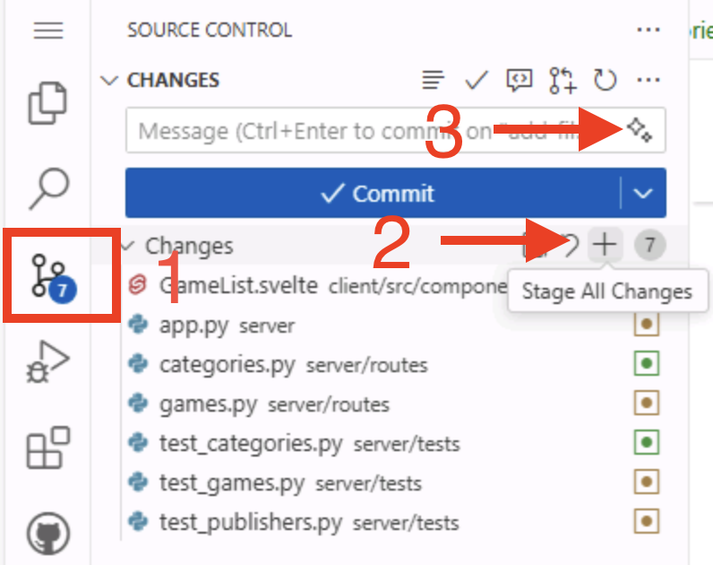

[← 上一课：代理模式][previous-lesson] · [下一课：自定义智能体 →][next-lesson]

你刚刚使用代理模式构建了筛选功能。创建拉取请求前，应确认它在浏览器中正常运行。无需亲自点击浏览应用，你可以连接 **Playwright MCP 服务器**，让 Copilot 操作真实浏览器并测试功能，然后发布分支并创建 PR。

本练习将学习如何：

- 了解模型上下文协议 (MCP) 以及 MCP 服务器如何为 Copilot 扩展新工具。
- 将 Playwright MCP 服务器添加到工作区。
- 让 Copilot 使用该服务器在浏览器中手动测试筛选功能。
- 发布分支，并为筛选工作创建拉取请求。

## 什么是模型上下文协议 (MCP)？

代理模式连接编辑器以外的工具后，功能会大幅增强。Copilot 通过模型上下文协议 (MCP) 实现这种连接，这是一种让智能体与外部工具和服务通信的标准方式。


[模型上下文协议 (MCP)](https://github.blog/ai-and-ml/llms/what-the-heck-is-mcp-and-why-is-everyone-talking-about-it/) 为 AI 智能体与外部工具和服务通信提供了一种方式。借助 MCP，AI 智能体可以实时访问最新信息（通过资源）并代表你执行操作（通过工具）。

AI 智能体通过 MCP 服务器访问这些工具和资源。MCP 服务器充当 AI 智能体与外部工具和服务之间的桥梁，负责管理智能体与外部工具（例如现有 API 或 NPM 包等本地工具）之间的通信。每个 MCP 服务器都提供一组 AI 智能体可以访问的工具和资源。

常见的 MCP 服务器包括：

- **[GitHub MCP Server](https://github.com/github/github-mcp-server)**：提供用于管理 GitHub 存储库的 API，允许 AI 智能体创建和更新存储库、管理议题和拉取请求等。
- **[Playwright MCP Server](https://github.com/microsoft/playwright-mcp)**：使用 Playwright 提供浏览器自动化功能，允许 AI 智能体浏览网页、填写表单和选择按钮等。

还有许多其他 MCP 服务器可以访问不同工具和资源。GitHub 托管了 [MCP 注册表](https://github.com/mcp)，帮助社区发现并参与生态建设。

> [!CAUTION]
> 从安全角度来看，请像对待项目中的其他依赖项一样对待 MCP 服务器。使用前应仔细审查其源代码、验证发布者，并考虑安全影响。只使用可信的 MCP 服务器，并谨慎授予其访问敏感资源或执行敏感操作的权限。

## 查看 MCP 配置

`.vscode/mcp.json` 文件用于配置 VS Code 工作区中可用的 MCP 服务器。

1. 在 Codespace 中打开 `.vscode/mcp.json`。
2. 你会看到已配置好的 `github` 服务器：

    ```json
    {
      "servers": {
        "github": {
          "type": "http",
          "url": "https://api.githubcopilot.com/mcp/"
        }
      }
    }
    ```

`github` 条目随项目模板提供，因此 Copilot 能在上一练习中读取议题待办列表。它使用[远程 GitHub MCP 服务器][remote-github-mcp-server]，无需在本地安装任何内容。VS Code 通过 HTTP 连接到该服务器，并在 Copilot 首次使用其工具时要求你进行 GitHub 身份验证。

## 添加 Playwright MCP 服务器

现在添加第二个服务器。[Playwright MCP 服务器][playwright-mcp-server]为 Copilot 提供可控的浏览器，正好适合测试功能。

1. 在 `.vscode/mcp.json` 中添加 `playwright` 条目，与 `github` 并列。文件应如下所示：

    ```json
    {
      "servers": {
        "github": {
          "type": "http",
          "url": "https://api.githubcopilot.com/mcp/"
        },
        "playwright": {
          "command": "npx",
          "args": ["@playwright/mcp@latest", "--headless"]
        }
      }
    }
    ```

2. 保存文件。

与远程 `github` 服务器不同，`playwright` 是**本地**服务器：VS Code 会在计算机上运行 `npx @playwright/mcp@latest` 来启动它。`--headless` 标记让 Playwright 在没有可见窗口的情况下运行浏览器。这是 Codespace 中的必要选项，因为其中没有桌面环境显示窗口。

> [!NOTE]
> Tailspin Toys 项目已在端到端测试中使用 Playwright，因此通常已经安装了 Playwright 所需的浏览器。如果 Copilot 后续报告缺少浏览器，请让它运行 `npx playwright install chromium`，然后重试。

## 启动并信任服务器

VS Code 会**按需**启动 MCP 服务器：Copilot 首次需要服务器工具时，VS Code 会启动服务器并询问你是否信任它。

1. 在 `.vscode/mcp.json` 中，`playwright` 条目上方会显示 **Start** 操作。选择该操作立即启动服务器，确认配置正确。
2. 如果 VS Code 询问是否信任服务器，请检查配置并选择信任，以便服务器启动。

手动启动是可选的。如果跳过此步骤，下一节中 Copilot 首次需要使用服务器工具时，VS Code 会启动服务器并提示你信任它。

## 测试筛选功能

[Playwright MCP 服务器][playwright-mcp-server]为 Copilot 提供可操作的真实浏览器。无需亲自点击应用检查工作，智能体可以打开页面、导航、应用筛选器并读取结果，然后向你总结观察到的情况。这是在不离开对话的情况下，快速确认功能行为是否符合预期的方法。

Playwright MCP 服务器在底层使用网页的[无障碍树][playwright-mcp-server]，而不是截图。这意味着智能体会像辅助技术一样，根据带有标签的结构化元素（按钮、链接和列表项）进行推理。因此，快速的功能检查也可以顺便检查基本的无障碍情况。

连接服务器并启动应用后，提示 Copilot 测试刚刚构建的筛选功能：

```text
使用 Playwright MCP 服务器，在浏览器中打开正在运行的应用 http://localhost:4321，并验证新的游戏筛选功能：

1. 打开游戏页面，并记录列出的游戏数量。
2. 应用类别筛选，确认列表仅显示该类别的游戏。
3. 清除筛选器，然后应用发行商筛选，确认列表只显示该发行商的游戏。
4. 同时应用类别和发行商筛选，确认结果同时符合两个条件。

报告每个步骤中的观察结果，并指出任何行为异常之处。
```

Copilot 会通过 Playwright MCP 服务器启动浏览器、完成每个步骤，然后报告结果。根据议题中的验收标准审查其总结。如果发现异常，请提出后续问题，或让它在创建拉取请求前修复代码。

> [!NOTE]
> 此测试要求应用在 `http://localhost:4321` 上运行。如果开发服务器已停止，请先重新启动，再发送提示。Copilot 首次使用 Playwright MCP 服务器时，可能需要下载浏览器；如果报告缺少浏览器，请让它运行 `npx playwright install chromium`，然后重试。

[playwright-mcp-server]: https://github.com/microsoft/playwright-mcp

## 发布分支并创建拉取请求

确认功能正常后，就可以创建拉取请求 (PR)，供团队审查了。首先发布 `filtering-vscode` 分支。

1. 打开 Codespace 中的 **Source Control** 面板，审查 Copilot 所做的更改。
2. 选择 **+** 图标暂存更改。
3. 使用 **Sparkle** 按钮生成提交消息。

   

4. 选择 **Publish**，将分支推送到存储库。

## 创建拉取请求

可以通过多种方式创建拉取请求，例如使用 github.com 或 GitHub 命令行界面 (CLI)。既然你正在使用 GitHub Copilot，就让它来创建 PR 吧！Copilot 可以找到相关议题并将其关联到 PR。

1. 打开 Copilot Chat 面板并选择 **New Chat**，开始新会话。
2. 在智能体下拉列表中确认选中 **Agent**，以便 Copilot 使用 GitHub 工具。
3. 使用以下提示让 Copilot 创建 PR：

   ```plaintext
   找到存储库中与按类别和发行商筛选相关的议题。从当前分支创建新的拉取请求，并将其关联到正确的议题。
   ```

4. 视需要选择 **Continue**，允许 Copilot 收集信息并执行操作。首次使用 GitHub 工具时，系统可能会要求你进行 GitHub 身份验证；按提示授权即可。
5. 观察 Copilot 如何搜索议题、找到正确的议题并创建 PR。
6. 选择 Copilot 生成的链接，审查拉取请求，但**暂时不要合并**。

## 总结与后续步骤

恭喜！本练习中，你：

- 了解了模型上下文协议 (MCP) 以及 MCP 服务器如何为 Copilot 扩展新工具。
- 将 Playwright MCP 服务器添加到工作区。
- 在发布前使用它通过浏览器手动测试筛选功能。
- 发布分支并为筛选工作创建拉取请求。

你使用 MCP 服务器测试了功能，但 MCP 只是扩展 Copilot 的一种方式。接下来，[创建自定义智能体][next-lesson]，简化无障碍审查等专门任务。

## 资源

- [什么是 MCP？为什么大家都在讨论它？][mcp-blog-post]
- [Microsoft Playwright MCP Server][playwright-mcp-server]
- [GitHub MCP Server][github-mcp-server]
- [GitHub MCP 注册表][mcp-registry]
- [VS Code 中的 MCP 服务器][vscode-mcp-config]

[previous-lesson]: ../2-agent-mode/
[next-lesson]: ../4-custom-agents/
[mcp-blog-post]: https://github.blog/ai-and-ml/llms/what-the-heck-is-mcp-and-why-is-everyone-talking-about-it/
[github-mcp-server]: https://github.com/github/github-mcp-server
[mcp-registry]: https://github.com/mcp
[remote-github-mcp-server]: https://github.blog/changelog/2025-06-12-remote-github-mcp-server-is-now-available-in-public-preview/
[vscode-mcp-config]: https://code.visualstudio.com/docs/agents/reference/mcp-configuration
