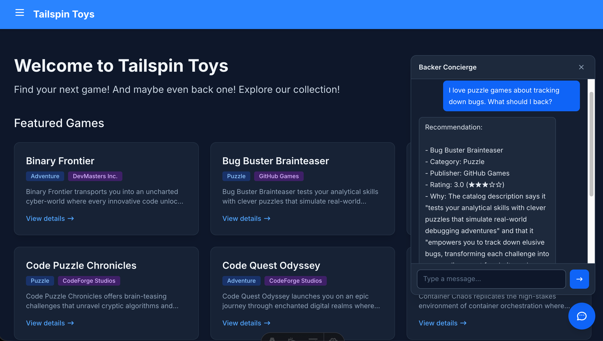

| [← 上一模块：构建并部署代理][previous-lesson] |
|:--|

本模块将[构建并部署代理][previous-lesson]中的托管代理连接到 Tailspin Toys。VS Code 中的 Copilot Chat 会创建本地集成，而不是公共生产端点。

## 目标

- 将凭据和 Foundry 对话标识符保留在本地服务器端代理服务中。
- 添加支持对话连续性的无障碍聊天小组件。
- 清理资源前，验证后端和完整体验。

## 场景

支持者应当无需离开目录，就能向推荐助手咨询建议。对话需要保留上下文、支持键盘操作，并保护私密连接详情。信任不仅取决于诚实的推荐，也取决于安全、无障碍的体验。

## 继续使用工作区

本次集成的目标是现有托管代理。Tailspin Toys 是完全预渲染的静态网站，因此浏览器代码无法安全保存代理的凭据。

1. 在 VS Code 中打开同一个 Tailspin Toys 存储库，切换到 `foundry-agent-vscode` 分支。确认上一个检查点中的托管代理在现有 `tailspin-toys` 项目中仍处于 **Running** 状态，且本地 Azure 登录指向其订阅。
2. 以普通 **Agent** 模式打开 Copilot Chat，而不是 **AIAgentExpert**。选择 **+**，再选择 **GitHub Issues**，然后选择 **Add a Backer Concierge assistant for catalog questions** 议题并附加。

## 构建并验证本地代理服务

`/api` 中的本地 Azure Functions 代理服务保存连接详情，并在网站本地运行时转发请求。Copilot 可以使用 **Azure skills** 准备和验证该服务。

> [!IMPORTANT]
> 本工作坊的代理服务仅用于本地开发。不要将其部署为允许匿名访问的公共端点。生产环境需要针对应用的身份验证和防滥用措施，包括速率限制或配额、CORS 限制、监控和成本控制。

1. 让 Copilot 创建代理服务：

   ```text
   在 api 中为静态 Astro 网站添加本地 Azure Functions 代理，以便开发期间安全地调用我已部署的 Backer Concierge。使用我现有的本地 Azure 登录身份调用托管代理，确保所有凭据不会暴露给浏览器，使用不透明句柄保护对话状态，验证请求、清理错误信息、添加针对性测试，并配置 Astro 开发服务器，使 /api 请求转发到本地 Function。不要创建面向公众的部署基础设施。
   ```

2. 接受更改前先审阅。确认凭据和 Foundry 对话标识符始终保留在服务器端、本地设置已排除在版本控制之外、请求设有边界限制，且针对性测试通过。
3. 构建 UI 前，先证明后端可以正常工作：

   ```text
   启动本地 Functions 主机，并通过询问“哪些游戏价格低于 30 美元？”来测试 /api/concierge。向我展示经过清理的响应，并确认不会返回凭据或内部对话标识符。
   ```

4. 检查终端响应。预期结果是有效的 JSON，其中 `response` 属性包含回答，且不包含虚构的价格信息、凭据或内部对话标识符。如果检查失败，让 Copilot 修复，然后重复后端测试。
5. 选择 **Keep** 保留更改，并使用 **/clear**，在同一个存储库和分支中为小组件开启全新聊天。保留本地代理服务配置和现有托管代理连接。

## 构建并测试小组件

UI 现在有了经过验证的后端。端到端测试将同时检查可用性和目录的信息边界。

1. 让 Copilot 添加小组件：

   ```text
   在 Astro 网站中添加无障碍的 Backer Concierge 聊天组件。将其连接到 /api/concierge，使用返回的不透明句柄保留对话，遵循现有设计指导，支持键盘操作，并确保可测试。
   ```

   

2. 保持 Function 和网站运行，然后验证完整体验：

   ```text
   使用 Playwright MCP 对 Backer Concierge 组件进行端到端测试。验证核心聊天流程、对话连续性、键盘和无障碍行为、依据边界，以及本地代理的安全使用情况。报告结果并修复任何失败项。
   ```

3. 根据议题验收标准审阅测试结果和更改：回答有数据依据、不虚构筹款金额、提出一个澄清问题、提供无障碍 UI 和端到端测试覆盖。确认失败项已修复，并重新运行受影响的检查。

## 完成检查点

你已构建可安全保管凭据的本地代理服务，接入了无障碍聊天小组件，并针对托管的 Backer Concierge 验证了完整对话流程。本模块的检查点是一个在本地通过测试的网站集成，它遵守目录边界，并使凭据和 Foundry 内部标识符不会暴露给浏览器。这不是代理服务或网站的生产部署。

体验结束后，请停止本地服务并[清理 Azure 资源][cleanup]，以免持续产生费用。然后返回核心工作坊的 [VS Code 概述][vscode-overview]。

[previous-lesson]: ../2-build-and-deploy/
[cleanup]: ../#清理资源
[vscode-overview]: ../../
